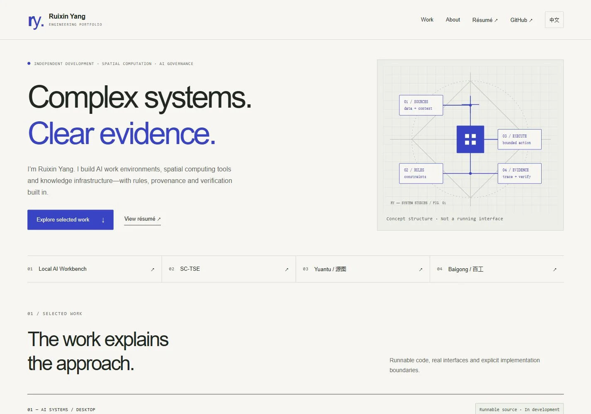

# Ruixin Yang — Engineering Portfolio

中英双语的技术作品集。重点介绍 Local AI Workbench、SC-TSE、Yuantu 与 Baigong，区分实际实现、研发原型和概念说明。

A bilingual engineering portfolio for AI work environments, spatial computation and traceable knowledge infrastructure. Each case study states its implementation boundaries.



## 本地预览 / Local preview

需要 Node.js 22.19+（本次使用 Node 24）。静态页面已提交，预览与构建不需要安装依赖：

```sh
git clone --branch feature/portfolio-redesign https://github.com/David7583/David7583.github.io.git
cd David7583.github.io
npm run preview
```

打开 `http://127.0.0.1:4173`。按 Ctrl+C 停止。可通过 `PORT` 环境变量选择其他端口。中文分享链接用 `?lang=zh`，英文用 `?lang=en`；语言设置会在站内跳转和刷新后保留。

Node.js 22.19+ is required. The committed HTML works directly on GitHub Pages; local preview and generation use only Node standard-library modules. No backend, API keys, accounts or external runtime assets are required. Open the address printed by the preview command.

## 编辑与检查 / Editing and checks

```sh
npm run build
npm test
```

- `scripts/build.mjs`: 中英文内容、共享结构、项目详情与简历生成器。编辑这里，再运行构建；不要只修改生成的 HTML。
- `assets/styles.css`: 颜色、排版、响应式布局、打印与减少动效样式。
- `assets/app.js`: 语言切换、图片 dialog、原图入口与简历打印。
- `scripts/workbench.mjs`: 首页重点产品与独立产品页的双语生成器。
- `assets/workbench-data.mjs`、`assets/workbench.js`、`assets/workbench.css`: 概念节点说明、导览/播放器交互与产品样式。
- `content/workbench-media.json`: 影片来源、字幕及发布审核状态；默认为空。接入流程见 [MEDIA.md](docs/MEDIA.md)。
- `scripts/image-sizes.json`: 已优化图片的真实尺寸；增加图片时同步更新。
- `scripts/check.mjs`: 六页结构、内部链接、锚点、图片尺寸及不发布 CI 的检查。

Optional development tools / 可选开发工具：

```sh
npm ci
npm run format
npm run build
npm test
```

另开终端保持 `npm run preview` 运行，再执行 `npm run audit`。Lighthouse 需要本机 Chrome/Chromium；无法自动发现时设置 `CHROME_PATH` 为浏览器可执行文件。报告保存在被忽略的 `.audit/lighthouse/`。网页不加载 Lighthouse 或 Prettier。

## 交付与发布 / Review and deployment

- [设计说明、参考研究与两轮迭代](docs/DESIGN.md)
- [验收与性能记录](docs/ACCEPTANCE.md)
- [素材及事实依据](docs/ASSETS.md)
- [Workbench 产品展示升级报告与本轮验收](docs/WORKBENCH_SHOWCASE_REPORT.md)
- [独立产品页桌面预览](docs/screenshots/showcase/final-product-desktop-en.webp) · [手机节点交互](docs/screenshots/showcase/final-flow-mobile-zh.webp)
- [桌面](docs/screenshots/final-desktop-zh.webp) · [平板](docs/screenshots/final-tablet-zh.webp) · [手机](docs/screenshots/final-mobile-zh.webp) · [完整首页](docs/screenshots/final-desktop-full.webp)

当前功能分支为 `feature/portfolio-redesign`，通过 Draft PR 审查。CI 只有检查权限，不部署。正式 GitHub Pages 仍从 `main` 根目录发布；只有所有者明确批准合并后，新版才应进入 `main`。没有创建新的云预览或修改正式 Pages 设置。

The feature branch is review-only. The CI workflow validates generated pages and local references; it has no deployment or write permissions. Production Pages remains sourced from `main`. Owner approval is required before merging and changing the live site.

The Workbench product page includes a clearly labeled interactive architecture guide, real software captures, implementation links and an on-demand video integration. The film is awaiting publication; its voice distribution rights must be confirmed before a public media URL is enabled. See the [showcase report](docs/WORKBENCH_SHOWCASE_REPORT.md) and [media integration guide](docs/MEDIA.md).

原始个人资料与图片来自既有公开站点；新增 Workbench 画面使用虚构数据的实际运行截图。不提交个人资料、密钥、本地数据库或大视频。没有修改原仓库的许可证政策。
