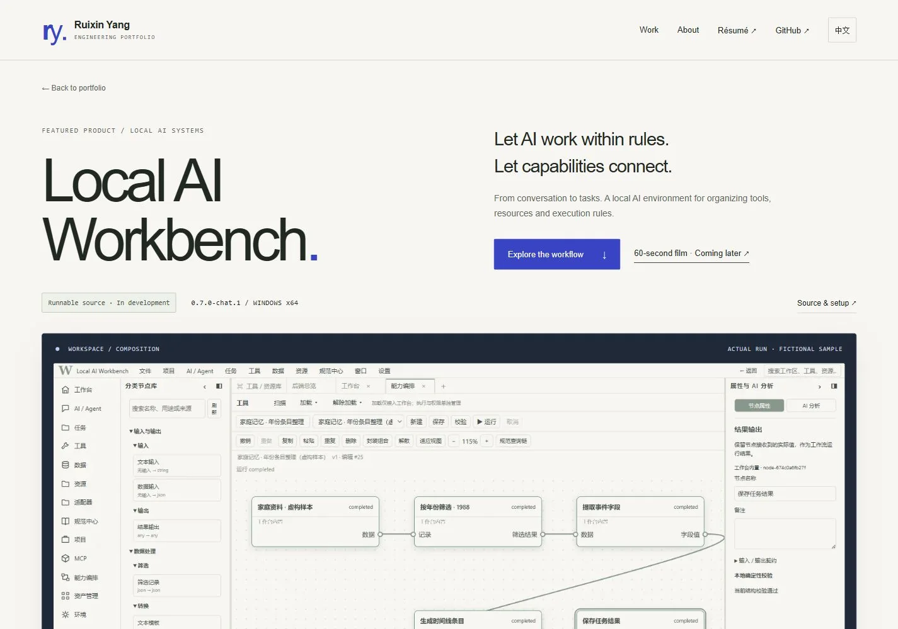

# Local AI Workbench 产品展示升级工作报告

日期：2026-10-17。分支：`feature/portfolio-redesign`。审查入口：[Draft PR #1](https://github.com/David7583/David7583.github.io/pull/1)。

## 完成情况

| 项目 | 结果与证据 |
|---|---|
| 首页 Featured Product | 真实编排截图、独立产品视觉容器、三项核心能力、源码和详情入口、60 秒影片入口。个人定位、其他三个代表项目、简历与联系方式继续保留。 |
| 独立产品页 | `projects/workbench.html`，包含产品主视觉、影片区、五步交互编排、六模块架构、真实执行范围及源码获取说明。 |
| 交互编排 | 点击、指针悬停、键盘焦点可查看作用、输入、输出与边界；方向键、Home/End、上一步/下一步、重置和有暂停功能的导览。整段明确标记“交互式架构示意 · 非实际执行”。 |
| 影片接入 | 原生播放器、按点击加载、字幕接口、错误/重试、源 URL 和授权状态校验。默认仍为真实封面和“待发布”，没有冒充在线成片。见 [MEDIA.md](MEDIA.md)。 |
| 双语与响应式 | 首页与产品页中英两种语言、桌面/平板/手机 12 组检查；另检查 320px 窄屏。没有横向页面溢出。 |
| 工程 | 保留静态 HTML/CSS/JS 和 GitHub Pages 兼容结构；不引入浏览器运行时依赖。构建生成 HTML，新增模块使用原生 ES modules。 |



## 视觉设计与两轮实际迭代

沿用本次作品集的暖白底、墨色正文、克制的蓝色强调与编辑式排版。真实软件画面放入深蓝工作环境边框，交互示意使用浅色网格；两者在颜色、标注和内容上明确区分。避免大面积同质卡片和无关三维效果。原参考研究与访问限制见 [DESIGN.md](DESIGN.md)，本次没有声称新增无法验证的获奖网站研究。

1. **第一轮**：浏览器中发现手机英文节点过高，输入输出类型挤占标题，说明面板离操作区较远。改为紧凑纵向步骤，类型详情保留在说明面板，增加“查看当前节点说明”入口，并放大状态字。实际修改前后：[之前](screenshots/showcase/round0-flow-mobile-en.webp) / [之后](screenshots/showcase/round1-flow-mobile.webp)。
2. **第二轮**：平板复查发现英文端口类型过小、节点标题高度不齐。放大类型文字并允许合理换行，统一标题占位；再次实测键盘操作和截图：[之前](screenshots/showcase/round1-tablet.webp) / [之后](screenshots/showcase/round2-tablet.webp)。

最终截图：[桌面产品页](screenshots/showcase/final-product-desktop-zh.webp)、[平板产品页](screenshots/showcase/final-product-tablet-en.webp)、[手机产品页](screenshots/showcase/final-product-mobile-en.webp)、[桌面交互](screenshots/showcase/final-flow-desktop-en.webp)、[手机交互](screenshots/showcase/final-flow-mobile-zh.webp)、[手机节点详情](screenshots/showcase/final-detail-mobile-zh.webp)、[完整产品页](screenshots/showcase/final-product-full-en.webp)。目录同时保存首页和产品页的中英文三尺寸截图。

## 测试结果

- `npm run build`：通过。`npm test`：6 个 Node 测试通过，同时检查 6 个双语页面、126 个本地引用/锚点、图片尺寸和禁止自动部署的 CI 配置。
- 浏览器实际验证：节点点击、ArrowRight、Home/End、下一步/上一步、首尾禁用、重置；说明内容和计数正确。语言切换后动态节点说明同步变为中文。架构详情可用 Enter 展开。真实截图 dialog 可打开，Escape 关闭并归还焦点。产品页控制台无错误。
- 当前浏览器启用了减少动效偏好，导览自动禁用且显示说明，手动操作可用。自动导览的推进、终点停止、重新开始、暂停、手动选择、重置、隐藏页面和偏好改变后的计时器清理由**实际模块的可控时钟测试**覆盖。普通动效模式不以静态截图作为动画流畅性证明。
- 本地隔离播放器：点击前无 video `src`；点击后读取到 60 秒时长并实际播放；Space 暂停、方向键调整进度。原生全屏按钮进入/退出全屏，静音按钮状态实际变化。缺失影片显示重试提示，重试可操作。播放器测试没有上传影片，也没有改动公共媒体配置。
- 本地 HTTP：ES module MIME、MP4 HEAD、起始和尾部范围请求、越界 416、隐藏 Git 路径 403 均通过。见 [HTTP 记录](evidence/showcase-preview-http.json)。
- 13 个唯一公开 GitHub 目标返回 HTTP 200，包括前后端、后端源码文件、许可证及其他项目。锚点由本地结构检查覆盖；外部 README 链接指向仓库 README。见 [外链记录](evidence/showcase-external-links.json)。
- [响应式尺寸记录](evidence/showcase-responsive.json)：1440×1000、834×1112、390×844，两个页面、两种语言均无横向溢出；320px 英文产品页也经浏览器检查。

### Lighthouse 13.5.0

本地 Chrome，默认移动端模拟或明确桌面配置；按需视频保持未加载。下列是本次测量，不是生产网络或所有设备上的性能承诺，也不等于完整 WCAG 人工审计。

| 页面与模式 | 性能 | 无障碍 | 最佳实践 | SEO | LCP | CLS |
|---|---:|---:|---:|---:|---:|---:|
| 首页中文 / Mobile | 100 | 100 | 100 | 100 | 1.4 s | 0 |
| 首页英文 / Desktop | 100 | 100 | 100 | 100 | 0.3 s | 0 |
| 产品页英文 / Mobile | 100 | 100 | 100 | 100 | 1.7 s | 0 |
| 简历中文 / Mobile | 100 | 100 | 100 | 100 | 1.1 s | 0 |

TBT 均为 0 ms。报告仍提示未压缩/未使用 CSS、缓存和资源加载优化机会；保留易维护源码并未将这些提示描述为不存在。摘要见 [Lighthouse 记录](evidence/showcase-lighthouse.json)，可用 `npm run audit` 重新生成完整本地报告。

## 素材和功能真实性

- 真实截图来自已有工作台运行证据和空工作台截图；仅使用虚构资料，没有新上传真实家庭数据。截图与五步示意不同：实测的是数据输入→年份筛选→字段提取→文本模板→结果输出，不代表通用 PDF/OCR 或语义分类已经验收。
- 架构说明对应 `workbench_workflows_v0002.cjs`、`workbench_adapter_catalog_v0001.cjs`、`workbench_governance_v0002.cjs` 和 `workflow_graph_v0001.mjs`；页面提供公开源码链接。
- 默认源码加载聊天与基础框架。模型、专业插件和外部工具需配置及授权。没有“所有数据绝不离开本机”或“所有旧工具均受统一权限覆盖”的断言。
- 版本标识沿用已核查的前端 `0.7.0-chat.1`，Windows x64 范围明确；Apache-2.0 链接指向 Workbench 本身，不为作品集擅自新增许可证。没有虚构安装包、Release 或 DOI。
- 新增视觉由 HTML/CSS 实现，没有购买或引入第三方字体、音乐、图片或三维资源。详见 [ASSETS.md](ASSETS.md)。

## 未完成与需要所有者决定

1. **影片正式接入**：需确认现有配音的公开分发许可，或替换为权利清晰的自录/授权配音；随后决定媒体托管地址。网页播放器和替换机制已经完成，此事项不阻塞基本浏览和交互。
2. **生产站发布**：本分支及 Draft PR 仅用于审查。只有所有者明确批准后才能合并 `main`；本次不创建 Release、不改 Pages 发布源。
3. **设备覆盖边界**：本次使用桌面浏览器的响应式视口；尚未在实体 iOS/Android、Safari、屏幕阅读器上验收。原生媒体全屏和字幕策略应随最终托管视频再做跨浏览器复测。

## 本地预览和两分钟审查路径

```sh
npm run build
npm test
npm run preview
```

打开 `http://127.0.0.1:4173`，在首页进入 Featured Product → 产品详情 → 探索能力编排 → 选择“智能分类”，查看候选分类与待核实边界 → 下一步/结果输出 → 展开“规范与权限” → 获取项目前后端源码。切换 EN 复查同一条路径；缩窄窗口检查纵向节点和说明入口。影片区当前诚实显示待发布状态。

## 保存与交付边界

开发过程已通过独立分支 Git 检查点保存：`d35e1ce`（产品区域与交互基础）、`8904608`（两轮响应式改进），后续测试、文档与验收证据随同分支提交。原项目业务数据、正式站点、主分支及 Workbench 前后端代码未在本次任务中修改。大型视频、私有 QA 页、原始工具日志与依赖目录均排除在源码提交之外。
